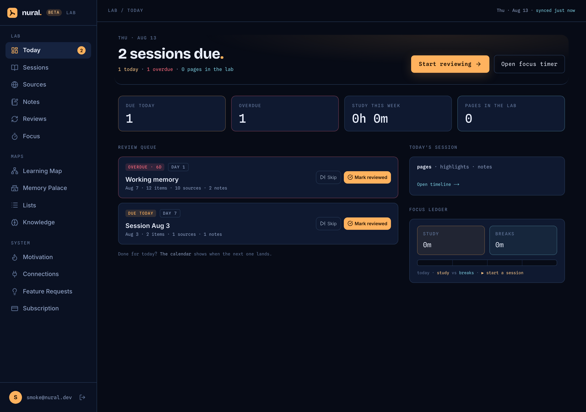
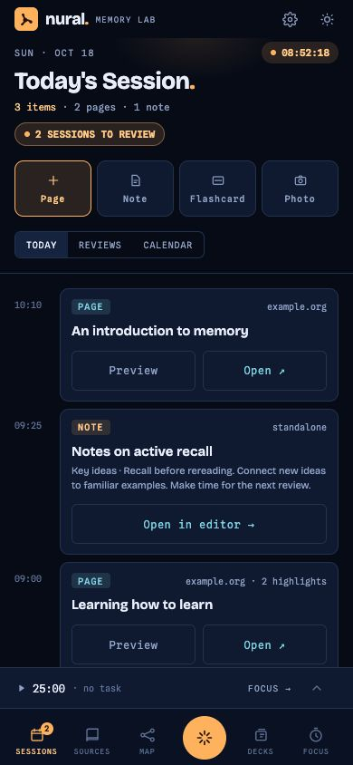
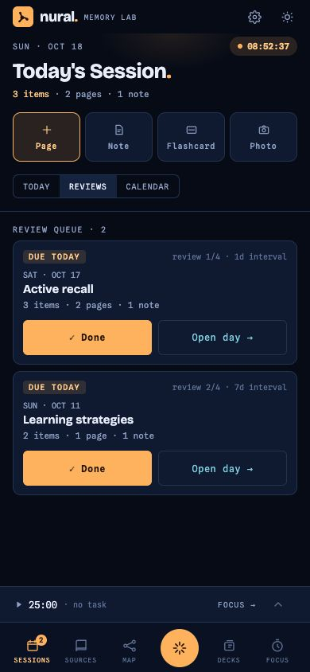
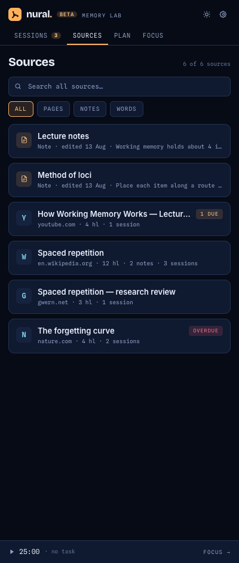
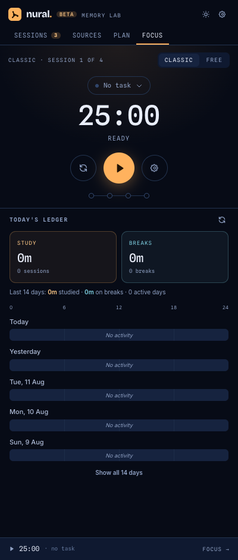
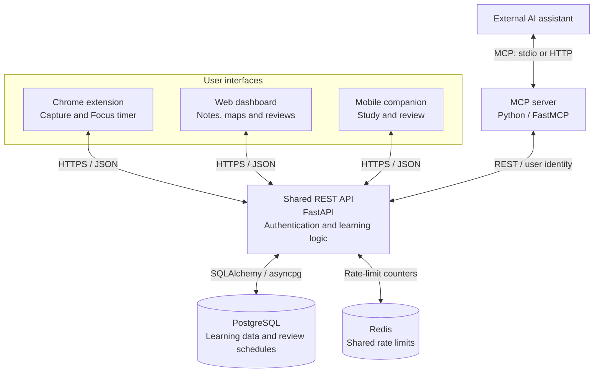

  <picture>
    <source media="(prefers-color-scheme: dark)" srcset="assets/nural-logo-dark.svg">
    <source media="(prefers-color-scheme: light)" srcset="assets/nural-logo-light.svg">
    
  </picture>

  <h1>Nural</h1>
  
Nural brings learning from scattered sources—across the web, mobile and AI conversations—into one system for planning, organizing study materials, and creating and managing reviews.

  

    
    
    
  

  

    <a href="https://nural.study">Product website</a> ·
    <a href="https://nural.study/beta">Beta access &amp; installation</a> ·
    <a href="https://nural.study/connect">Connect an AI assistant</a>
  

## The product

Learning happens in different places: a page in your browser, material on your phone, or a conversation with an AI assistant. Keeping track of what to study, what you have already worked on, and what needs another review can become a separate task.

Nural gives that process a shared structure. You can plan topics and study time, organize materials, record your learning in daily sessions, and prepare notes and flashcards for review. Scheduled reviews help you return to what you studied. Through MCP, an AI assistant can work with the same learning history and materials.

The product is in **closed beta**. It includes a web dashboard, a Chrome extension, mobile companion apps and an MCP integration. Access and distribution vary by platform; the [beta guide](https://nural.study/beta) is the current reference.

| What you want to do | How Nural supports it |
| --- | --- |
| Capture something while learning | Highlight text on a web page, add a page note, or save a timestamp in a video. Captures retain their source context. |
| Find what you studied | Browse dated sessions and their material through the dashboard timeline and calendar. |
| Organize a subject | Arrange topics in a learning map, connect related concepts, and attach existing sources, highlights or notes. |
| Write and practice | Create notes in a visual or Markdown editor; create flashcards and review them in quizzes. |
| Return to previous learning | Follow a session review queue and a separate queue of due flashcards. |
| Study with an AI assistant | Use MCP to inspect learning history, organize map topics, write notes, create flashcards and run a conversational quiz. |
| Keep track of study time | Use the extension's Focus timer and view recorded study and break periods. |

## A look inside

### Web dashboard

*An existing beta dashboard capture with synthetic test sessions and a dummy account. The displayed values are sample data.*

### Mobile app

<table>
  <tr>
    <th>Today's learning session</th>
    <th>Session review queue</th>
  </tr>
  <tr>
    <td align="center"></td>
    <td align="center"></td>
  </tr>
</table>

*Phone-sized captures of the actual Expo / React Native app running in its web preview, with synthetic demo data.*

### Chrome extension

<table>
  <tr>
    <th>Sources in the side panel</th>
    <th>Focus timer</th>
  </tr>
  <tr>
    <td align="center"></td>
    <td align="center"></td>
  </tr>
</table>

*Existing beta side-panel screenshots with sample material and an empty Focus history.*

## Architecture

The clients share one REST backend. It owns authentication, access checks, learning records and review scheduling. The MCP server adapts that API for external AI assistants; it does not maintain a second copy of the learning data.

The web dashboard uses Next.js. The Chrome extension runs as a Manifest V3 extension, with page capture in content scripts and the Focus timer managed by its service worker. The mobile app uses Expo and React Native, with native Swift and Kotlin modules for platform-specific capabilities. Containerized web services are deployed on Azure through GitHub Actions.

### From a highlight to a review

1. **Capture:** a user highlights text in the extension. The request includes the page URL, selected text and an anchor used to locate the selection again.
2. **Associate:** the API resolves the source and the user's target session. Normally that is the client's calendar day; an explicit session or an active review can supply a different context. A highlight belongs to both a source and a session.
3. **Schedule:** new content in today's session initializes that day's review schedule, with intervals of **1, 7, 28 and 112 days**. Subsequent captures reuse the schedule. Adding content during a review of an older day does not restart it.
4. **Return:** clients retrieve due sessions and their material. Completing a session review updates the shared record; grading a flashcard updates that card's independent schedule.

A **source** identifies the original material. A **capture** records something the user took from it. A **session** groups study content by day. A **map topic** organizes knowledge and can link to existing material. These concepts are related, but have separate responsibilities.

## Technical decisions

| Decision | Implementation and consequence |
| --- | --- |
| **Keep learning rules in one backend** | Browser, web, mobile and MCP clients call the same API. Session assignment, ownership checks and review scheduling stay in the service layer rather than being reimplemented for each interface. |
| **Separate session review from card practice** | Session reviews revisit a whole study day on a fixed schedule. Flashcards use individual Leitner or SM-2-style schedules. Completing one does not automatically grade the other. |
| **Keep Focus state outside the side panel** | A service worker owns timer transitions and persists live state locally. Recorded periods enter a retry queue and carry client-generated IDs that the backend deduplicates. Closing the panel does not discard the running timer. |
| **Highlight without wrapping page content** | The extension uses the CSS Custom Highlight API to paint text ranges. Stored anchors combine DOM positions with text context for restoration. This avoids inserting wrapper elements into the page, though changed page content can still invalidate an anchor. |
| **Use Markdown as the note format** | The visual editor is available only when content can be converted without loss. Unsupported formatting stays in Markdown mode. Rendering uses an explicit element and URL allowlist, with raw HTML kept inert. |
| **Give MCP the caller's identity** | The remote MCP transport uses OAuth with scoped access. The adapter forwards the authenticated user's token to the API and checks write scopes, keeping AI operations within the same authorization boundary. |

## Technology

  

| Area | Technologies in use |
| --- | --- |
| Chrome extension | TypeScript, React, Manifest V3, Webpack, Chrome storage and alarms |
| Web dashboard | Next.js, React, TypeScript, Tailwind CSS, TanStack Query, React Flow, Tiptap |
| Backend and data | Python, FastAPI, Pydantic, SQLAlchemy, asyncpg, PostgreSQL, Alembic; Redis for shared rate limiting |
| AI integration | Model Context Protocol, Python FastMCP, httpx, OAuth |
| Mobile | Expo, React Native, TypeScript; Swift and Kotlin native modules |
| Delivery | Docker, Azure Container Apps, GitHub Actions, OpenTofu |

The delivery workflow runs the shared CI checks before deployment. These include Python linting and backend tests, dashboard linting and a production build, extension tests and a production build, and mobile type checks, linting and tests. Database-sensitive backend tests use PostgreSQL and Redis services.

## My role

I am **[Piotr Ludwig](https://github.com/Pyot)**. I lead the product direction and architecture discussions: defining the learning workflows, shaping the domain concepts, and deciding which responsibilities belong in the dashboard, extension, mobile app and AI integration.

## About this repository

This repository presents Nural's product, architecture and selected visuals. The application implementation remains private. It contains no application source, deployment configuration or customer data, and is not an open-source distribution of Nural.

Technology icons by [Skill Icons](https://github.com/tandpfun/skill-icons); badges by [Shields.io](https://shields.io/).
